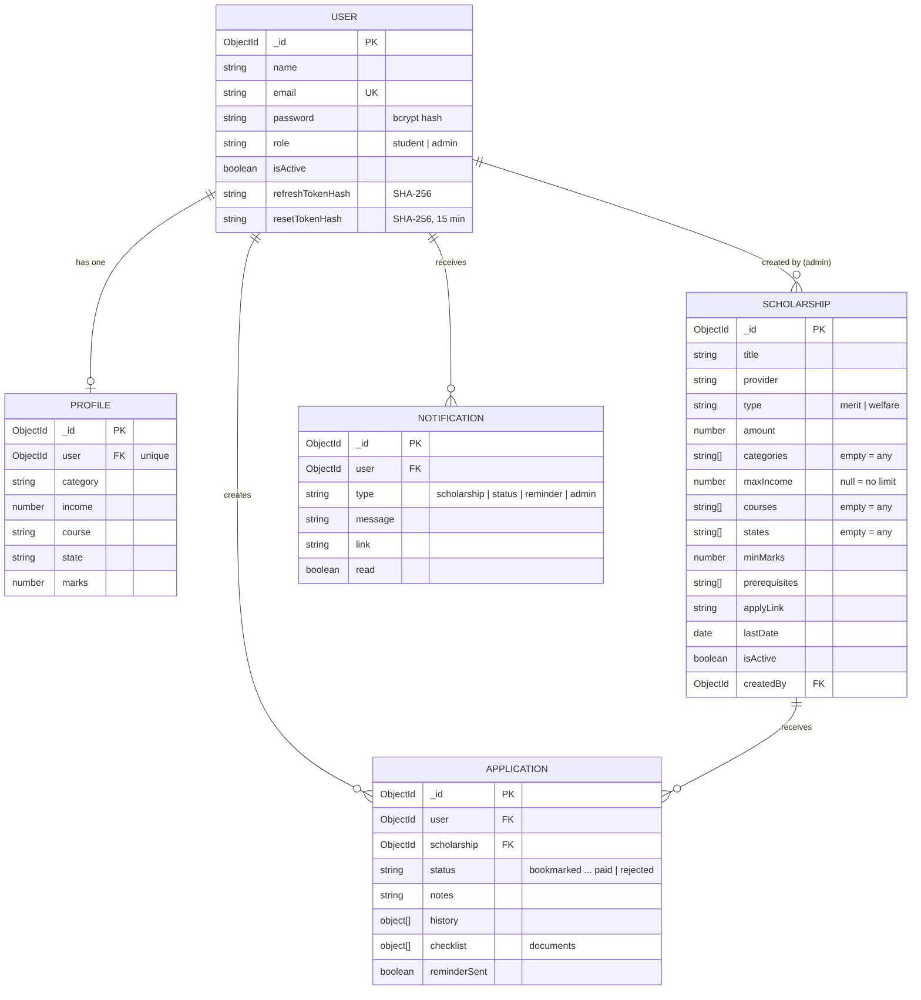

# ScholarMatch – Scholarship Finder

> Fill your profile once. ScholarMatch matches it against every scholarship's rules, shows what you are eligible for, and warns you before deadlines.

MERN capstone project (Topic 25). Stack: **MongoDB, Express, React, Node.js** + Mongoose, JWT, bcrypt, Socket.IO.

## Features

**Student**
- Register / login with **JWT access + refresh tokens** (refresh-token rotation), passwords hashed with **bcrypt**
- One-time **profile**: category, family income, course, state, marks
- **Find Scholarships**: search, filters (category, course, state, merit/welfare, income), sort, pagination
- **Eligible for You** (the unique twist): a MongoDB query that matches the profile against each scholarship's rules
- **Closing in 7 days** list with colour-coded deadline badges
- **Why am I (not) eligible?** – a rule-by-rule table on every scholarship, and an "Almost eligible" list (exactly one rule missing)
- **Bookmarks** and **application tracker** following the National Scholarship Portal stages: Applied → Institute verification → L2 verification → Sanctioned → Payment released (or Rejected)
- **Real-time notifications** (Socket.IO) that are also **saved in MongoDB**: a new scholarship you qualify for, a status change, or a deadline reminder. Nothing is lost while you are offline
- **Deadline reminders**: a background job (hourly) reminds you once when a *bookmarked* scholarship closes within 3 days
- **Documents checklist** per scholarship (income certificate, marksheet, …) with a progress bar
- **Total potential support**: "Up to ₹X per year across N eligible scholarships" on the dashboard
- **Compare scholarships**: pick up to 3 and see amount, deadline, rules and your eligibility side by side
- **Hindi / English** toggle and **dark mode**
- **Forgot / change password** (see note below about email)

**Admin** (RBAC)
- Add / edit / delete scholarships with rules (category, income limit, course, state, minimum marks) and last date
- Move applications through the verification stages
- Manage students (view profile, deactivate / activate)
- **Import scholarships from CSV** (template download, per-row validation report) and **export applications to CSV**
- Dashboard built from MongoDB **aggregation pipelines**

## Tech and where each requirement is met

| Requirement | Where |
|---|---|
| MVC structure | `backend/src/{models,controllers,routes,middleware,config}` |
| `.env`, never committed | `backend/.env.example`, `.gitignore` |
| bcrypt + JWT access/refresh | `controllers/auth.controller.js`, `utils/tokens.js` |
| Protected + RBAC routes | `middleware/auth.js` (`protect`, `authorize('admin')`) |
| Mongoose validation + relationships | `models/*` (User 1:1 Profile, User n:m Scholarship via Application) |
| Aggregations (3) | `controllers/report.controller.js`, `dashboard.controller.js` |
| Indexes | `User.email` (unique), `Scholarship {isActive,lastDate}`, text index, `{categories}`, `Application {user,scholarship}` (unique) |
| Centralised error handling | `middleware/error.js` |
| EventEmitter | `events/emitter.js`, `events/listeners.js`, `jobs/reminders.js` |
| Socket.IO | `sockets/socket.js` (JWT-authenticated, rooms `user:<id>` and `admins`) |
| Postman collection | `postman/ScholarMatch.postman_collection.json` (82 requests with tests) |
| React: routing, controlled forms, Context API, protected pages | `frontend/src` |

## Prerequisites
- Node.js 18+
- MongoDB running locally (`mongodb://127.0.0.1:27017`) or a MongoDB Atlas connection string

## Setup

```bash
# 1. Backend
cd backend
cp .env.example .env        # then edit the two JWT secrets (see comment inside)
npm install
npm run seed                # creates demo users + scholarships (wipes existing data!)
npm run dev                 # http://localhost:5000

# 2. Frontend (new terminal)
cd frontend
npm install
npm run dev                 # http://localhost:5173
```

The Vite dev server proxies `/api` and `/socket.io` to the backend, so no CORS or URL configuration is needed in development.

### Environment variables (`backend/.env`)

| Variable | Meaning |
|---|---|
| `PORT` | API port (default 5000) |
| `MONGO_URI` | MongoDB connection string |
| `CLIENT_URL` | Frontend origin allowed by CORS / Socket.IO |
| `JWT_ACCESS_SECRET`, `JWT_REFRESH_SECRET` | Two different long random strings |
| `JWT_ACCESS_EXPIRES`, `JWT_REFRESH_EXPIRES` | e.g. `15m`, `7d` |
| `AUTH_RATE_LIMIT_MAX` | Auth attempts per IP per 15 minutes |
| `API_RATE_LIMIT_MAX` | Requests per IP per 15 minutes for the whole API |

### Demo accounts (after `npm run seed`)

| Role | Email | Password |
|---|---|---|
| Admin | admin@scholarmatch.test | Admin@123 |
| Student (profile filled) | student@scholarmatch.test | Student@123 |
| Student (profile filled) | priya@scholarmatch.test | Student@123 |
| Student (no profile) | rahul@scholarmatch.test | Student@123 |

> Scholarship names are real public schemes, but **amounts and eligibility rules in the seed data are sample values**. Always check [scholarships.gov.in](https://scholarships.gov.in/) for official rules.

## How the "Eligible for you" twist works

Each scholarship stores rules. An empty list or `null` means "no restriction".

```js
{ isActive: true, lastDate: { $gte: now },
  $and: [
    { $or: [{ categories: { $size: 0 } }, { categories: profile.category }] },
    { $or: [{ maxIncome: null },          { maxIncome: { $gte: profile.income } }] },
    { $or: [{ courses: { $size: 0 } },    { courses: profile.course }] },
    { $or: [{ states: { $size: 0 } },     { states: profile.state }] },
    { minMarks: { $lte: profile.marks } } ] }
```

`utils/eligibility.js` has the same rules in JavaScript (`evaluate`) to explain *which* rule passed or failed. "Closing in 7 days" is `lastDate` between now and now + 7 days, served by the `{isActive, lastDate}` index.

## Real-time flow (EventEmitter + Socket.IO)

```
Admin POST /api/scholarships
  -> controller saves it, emits  events.emit('scholarship:created', doc)
  -> listener loads profiles, evaluates each, and for eligible students
     io.to('user:<id>').emit('scholarship:new', ...)
  -> the notification is saved in MongoDB, then the student's browser shows a toast and a bell notification

Admin PATCH /api/applications/:id/status -> 'application:statusChanged' -> student notified
Hourly job (jobs/reminders.js)           -> 'deadline:reminder'         -> student notified (once per bookmark)
Student marks "applied"                  -> 'application:applied'       -> admins notified
```

Socket connections must send a valid access token (`auth: { token }`); invalid tokens are rejected in the handshake.

## Database design



| Collection | Key fields | Indexes |
|---|---|---|
| `users` | name, email, password (hash), role, isActive, refreshTokenHash, resetTokenHash, resetTokenExpires | `email` unique |
| `profiles` | user → users, category, income, course, state, marks | `user` unique (1:1) |
| `scholarships` | title, provider, type, amount, rules (categories, maxIncome, courses, states, minMarks), prerequisites, applyLink, lastDate, isActive | `{isActive, lastDate}`, text(title, provider, description), `{categories}` |
| `applications` | user → users, scholarship → scholarships, status, notes, history, checklist, reminderSent | `{user, scholarship}` unique, `{status}`, `{scholarship, status, reminderSent}` |
| `notifications` | user → users, type, message, link, read | `{user, createdAt}`, TTL index (auto-delete after 60 days) |

### Aggregation pipelines
1. **Applications by status** (`/api/reports/overview`): `$group` + `$sort`
2. **Applications by scholarship** (`/api/reports/applications-by-scholarship`): `$group` with `$cond` counters → `$lookup` → `$unwind` → `$project` → `$sort` → `$limit`
3. **Scholarships by category** (`/api/reports/scholarships-by-category`): `$match` → `$unwind` (categories) → `$group` (count, total, average)
4. Student progress counts (`/api/dashboard/student`): `$match` + `$group`

## REST API

All responses: `{ "success": true, "data": …, "meta"?: … }` or `{ "success": false, "message": "…", "errors"?: [{field, message}] }`.
Auth: `Authorization: Bearer <accessToken>`.

| Method & path | Auth | Description |
|---|---|---|
| POST `/api/auth/register` | – | Create a student account (role cannot be chosen) |
| POST `/api/auth/login` | – | Returns user + access + refresh token |
| POST `/api/auth/refresh` | – | Rotates tokens; reuse of an old refresh token revokes the session |
| POST `/api/auth/logout` | any | Revokes the refresh token |
| POST `/api/auth/change-password` | any | `{currentPassword, newPassword}`; returns fresh tokens |
| POST `/api/auth/forgot-password` | – | `{email}`; same answer whether or not the account exists |
| POST `/api/auth/reset-password` | – | `{token, password}` |
| GET `/api/auth/me` | any | Current user |
| GET `/api/meta` | – | Dropdown values (categories, courses, states, statuses) |
| GET / PUT `/api/profile` | student | Read / create-or-update own profile |
| GET `/api/scholarships` | any | Search (`q`), filters (`category, course, state, type, income`), `sort`, `page`, `limit`, `status=open\|expired\|all` |
| GET `/api/scholarships/eligible` | student | Scholarships matching the profile |
| GET `/api/scholarships/closing-soon?days=7` | any | Closing within N days |
| GET `/api/scholarships/:id` | any | One scholarship (+ eligibility for students) |
| POST / PATCH / DELETE `/api/scholarships[/:id]` | admin | Manage scholarships |
| POST `/api/applications` | student | Bookmark or apply `{scholarshipId, status}` |
| GET `/api/applications/mine` | student | Own bookmarks and applications |
| PATCH / DELETE `/api/applications/:id` | student (owner) | Toggle bookmarked/applied, notes, remove |
| PATCH `/api/applications/:id/checklist` | student (owner) | `{index, done}` tick a document |
| GET `/api/applications/export?status=` | admin | CSV download |
| POST `/api/scholarships/bulk` | admin | `{items:[…]}` up to 200 rows; returns `{created, failed:[{row, errors}]}` |
| GET / PATCH / DELETE `/api/notifications[/read-all]` | any | Own notifications, mark all read, clear |
| POST `/api/reports/run-reminders` | admin | Runs the deadline-reminder job now (for demos) |
| GET `/api/applications` | admin | All submitted applications |
| PATCH `/api/applications/:id/status` | admin | Move through the stages |
| GET `/api/dashboard/student` | student | Stats, eligible, closing, almost-eligible, progress |
| GET `/api/reports/{overview,applications-by-scholarship,scholarships-by-category}` | admin | Aggregations |
| GET `/api/reports/trend?range=daily\|weekly\|monthly\|yearly` | admin | Time-bucketed applications and registrations (line chart) |
| GET `/api/reports/recent-activity` | admin | Merged feed of registrations, application updates, new scholarships |
| GET `/api/users`, PATCH `/api/users/:id/active` | admin | Manage students |

Status codes used: 200, 201, 400 (validation / bad id), 401 (no or bad token), 403 (wrong role), 404, 409 (duplicate / conflict), 429 (rate limit), 500.

## Security notes
- Passwords: bcrypt (cost 12), never returned (`select: false`)
- Refresh tokens are stored only as SHA-256 hashes and rotated on every use
- Role is never accepted from request bodies; admins come from the seed script
- Students can only touch their own applications (queries include `user: req.user.id`; others get 404)
- Request body limit 10 kb, ObjectId validation, string coercion on query params (blocks operator injection)
- **helmet** security headers, a general API rate limit and a stricter limit on login/register/reset routes
- CSV export neutralises spreadsheet formulas (cells starting with `= + - @`)
- Password reset: random token, only its SHA-256 hash is stored, expires in 15 minutes, logs the user out everywhere. **No email service is connected**: the reset link is printed in the backend terminal and, outside production, shown on the page (`devResetLink`). To go live, send that link with an email provider such as Nodemailer in `auth.controller.js`
- Known limitations (acceptable for a college project): one active session per user, tokens kept in `localStorage` on the client, in-memory rate limiter (resets on restart), Hindi translation covers student screens and navigation only

## Testing with Postman
Import `postman/ScholarMatch.postman_collection.json` (re-run `npm run seed` before each full run, because the tests change data), make sure the backend is running and seeded, then use **Run collection**. It contains success, validation-failure, not-found, unauthorized (401), forbidden (403), duplicate (409) and business-rule cases, with assertions in every request.

## Suggested demo script (viva)
1. Log in as the student → dashboard → show "Eligible for you" and the rule-by-rule table.
2. Change the profile (e.g. income) → dashboard updates.
3. Open a second browser as admin → add a scholarship the student qualifies for → the student's bell rings instantly (EventEmitter → Socket.IO).
4. Admin moves the student's application to *Sanctioned* → student sees the tracker update.
5. In Postman (as admin) call `POST /api/reports/run-reminders` → the student receives the deadline reminder for the bookmarked "AICTE" scholarship.
6. Show Compare, the documents checklist, dark mode and the Hindi toggle.
5. Explain one request end to end: Route → `protect` → `authorize` → controller → model → MongoDB → response.

## Folder structure
```
scholarmatch/
├─ backend/ (server.js, src/{config,models,controllers,routes,middleware,events,sockets,utils,seed})
├─ frontend/ (src/{components,context,pages,api.js,hooks.js,styles.css})
├─ postman/  docs/
```

## References
- Express: https://expressjs.com/
- Mongoose (schemas, validation, aggregate): https://mongoosejs.com/docs/
- MongoDB aggregation pipeline: https://www.mongodb.com/docs/manual/core/aggregation-pipeline/
- MongoDB indexes: https://www.mongodb.com/docs/manual/indexes/
- JSON Web Tokens: https://jwt.io/introduction and https://github.com/auth0/node-jsonwebtoken
- bcrypt: https://github.com/kelektiv/node.bcrypt.js
- Node.js `events` (EventEmitter): https://nodejs.org/api/events.html
- Socket.IO (server, rooms, middleware): https://socket.io/docs/v4/
- React: https://react.dev/ · React Router: https://reactrouter.com/ · Vite: https://vite.dev/
- Fetch API: https://developer.mozilla.org/en-US/docs/Web/API/Fetch_API
- Postman tests: https://learning.postman.com/docs/tests-and-scripts/write-scripts/test-scripts/
- OWASP REST / authentication cheat sheets: https://cheatsheetseries.owasp.org/
- National Scholarship Portal (domain reference for stages and scheme types): https://scholarships.gov.in/
